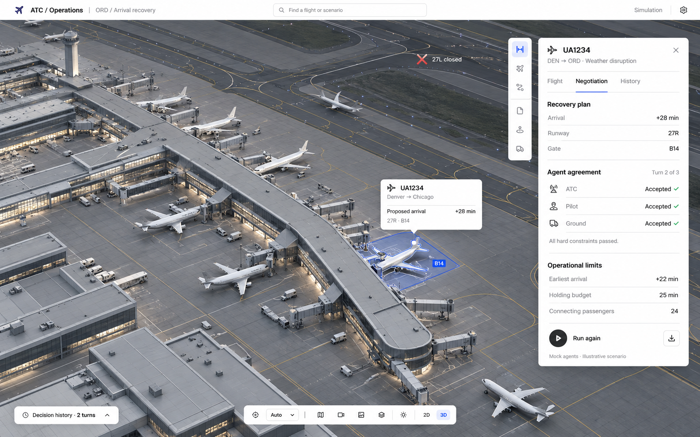

# Shared design system

Status: approved visual direction, 31 October 2026. Owners: Bill and Daniel.

This is the visual source of truth for the project. It documents the direction Bill approved after rejecting the earlier A/B/C dashboard mockups. It contains a reference image, design tokens, component specifications, and collaboration boundaries. It does not implement the application.

## Start here

1. Use the [approved workspace](assets/approved-workspace.png) as the visual reference.
2. Use [tokens.css](tokens.css) for shared visual values. These are proposed implementation values matched to the approved direction, not measurements extracted from the image.
3. Follow [components.md](components.md) for component behaviour, data mapping, and states.
4. Follow [team-handoff.md](team-handoff.md) for ownership and integration boundaries.
5. Read the [backend contract](../contracts/CONTRACT.md) and [generated types](../contracts/types.ts) before connecting data. Generated schemas govern payload shape; this system governs presentation.

## Approved reference

The image is a generated visual concept, not a running application or an accurate model of Chicago O'Hare. Its airport treatment and interface composition are approved. Its sample values, inferred aircraft positions, tool icons, and details are not additional product requirements. Use actual API data and only expose controls that work.

## Design direction

A detailed, desaturated 3D airport fills the workspace. A slim white toolbar and one white contextual inspector float above it. The airport remains visible and usable while the operator inspects a flight or negotiation.

Keep the airport as shown in the approved image: realistic terminal geometry, jet bridges, white aircraft, concrete apron, restrained markings, and soft daylight. Preserve its depth and detail. Do not replace it with white block geometry, a flat map, or a nighttime neon scene as the default.

The interface uses neutral text, careful alignment, fine dividers, and small controls. Blue marks selection. Green marks a confirmed pass or agreement. Red marks a failed hard constraint. Operational information should be easy to read without competing with the scene.

## Workspace composition

Reference viewport: 1600 × 1000. Values below are CSS pixels.

| Element | Default specification |
| --- | --- |
| Top toolbar | 48px tall; white; fine bottom border; product name, airport/scenario context, scenario search, simulation label |
| Airport canvas | Fills all remaining viewport space, including behind overlays; roughly 70–75% stays unobscured on a wide desktop |
| Flight inspector | One floating white panel; 340px wide, up to 380px on wider screens; 24px from right and below toolbar; 20px interior padding |
| Inspector height | Fits available viewport; scroll its content internally; keep tabs and relevant actions reachable |
| Context tools | Optional narrow 44px floating palette alongside the inspector; only implemented tools |
| Selected-flight tooltip | About 220px wide; anchored to selected scene object, positioned to avoid inspector and viewport edges |
| View controls | Compact bottom-centre dock; only useful camera/view controls; no duplicated navigation |
| Decision history | Collapsed bottom-left handle by default; expands on request |

The default screen has no permanent left navigation rail, full-height left information column, or always-open comparison strip. Scenario search opens a temporary list. Detailed information belongs in the inspector or history drawer.

## Visual foundations

### Colour

| Purpose | Value | Use |
| --- | --- | --- |
| Panel | `#FFFFFF` | Inspector, tooltip, toolbar |
| Subtle surface | `#F6F6F6` | Hover, small grouped controls |
| Primary text | `#242424` | Titles, values, main actions |
| Secondary text | `#6B6B6B` | Labels and helper text; darker than the mockup for readability |
| Divider | `#E7E7E7` | Row and section separation |
| Control border | `#8A8A8A` | Boundaries that must be distinguishable for interaction |
| Selection | `#2453FF` | Active tab underline, selected gate/aircraft outline, focus |
| Selection fill | `rgba(36, 83, 255, 0.08)` | Selected stand footprint or subtle selected row |
| Success | `#1F7A46` | Small check plus explicit text |
| Caution | `#946200` | Fallback or soft operational warning |
| Failure | `#BC3030` | Failed hard rule, closure, error |

Use status words and icons with colour. Agent identity is conveyed by name and a neutral icon, not three different card colours. Keep broad coloured surfaces out of the default view.

### Typography

Use one neutral sans-serif family: Inter when supplied locally, with system UI fallbacks. Use tabular numerals for times and aligned numeric values.

| Role | Size / line height | Weight |
| --- | --- | --- |
| Inspector flight identity | 16 / 24px | 600 |
| Section title | 14 / 20px | 600 |
| Body, tabs, data rows | 13 / 20px | 400–500 |
| Supporting text | 12 / 18px | 400 |

Use sentence case. Keep airport codes and flight identifiers in their natural uppercase form. Avoid oversized headings, wide letter spacing, condensed type, and bold text on every row.

### Spacing and surfaces

- Spacing scale: 4, 8, 12, 16, 20, 24, 32px.
- Data rows: at least 36px tall; labels left, values right.
- Separate sections with a line and space. Avoid wrapping each section in another card.
- Floating panel radius: 10px. Small controls: 6px. Status text normally has no enclosing pill.
- Use one subtle shadow for floating surfaces. Nested content stays flat.
- Use a consistent outline icon family, typically 16px at a 1.5px stroke. Avoid emoji, shaded icon tiles, and mismatched filled icons.
- Primary run control: charcoal circular play icon with a visible text label, matching the reference. Its meaning must remain clear without relying on the icon.

## Airport and selection

Keep the camera elevated at an isometric-like angle with enough space around the terminal. Use subdued materials so overlays and the selected aircraft remain readable. Avoid pulsing runways, luminous route trails, exaggerated bloom, or automatic camera movement during negotiation.

Selection uses a thin blue outline, a faint stand footprint, and one compact tooltip. A runway closure uses a small red cross and a short label. Keep labels readable against the scene with a neutral backing where needed.

The backend does not provide airport topology, aircraft coordinates, taxi paths, service vehicles, or motion telemetry. Any scene geometry and aircraft placement are illustrative. Keep a visible “Illustrative airport layout” label. “Simulation” describes the workspace even when real LLM calls are enabled; “Live AI” must not imply live airport telemetry.

Use a mapping from scenario runway/gate names to illustrative scene anchors. Never assume every scenario uses 27R or B14. Unknown names must remain available in the inspector and accessible list; do not silently attach them to the wrong geometry.

## Responsive and accessible behaviour

- At 1280px and above: use the floating layout and full inspector.
- At 900–1279px: narrow the inspector to about 320px, hide optional tools, and keep the tooltip away from it.
- Below 900px: make the inspector an explicitly opened bottom sheet; collapse topbar search to a button. Below 600px, allow a full-width details sheet. Do not shrink desktop text to fit.
- Keep body text readable at 200% zoom. Dense comparison content can scroll horizontally within its drawer.
- All scene selections must also be available through keyboard-accessible lists. Give icon buttons accessible names and visible focus indicators.
- Use at least 32px desktop hit areas and 44px touch hit areas. Colour alone never identifies a state.
- An opened inspector does not trap focus unless it behaves as a modal. Escape closes temporary overlays and returns focus to their trigger.
- Announce concise negotiation progress and completion, rather than reading the entire event log on each update.
- Respect reduced motion. Avoid automatic orbiting or camera sweeps. A future non-WebGL fallback should preserve the flight, constraints, and negotiation workflow through a labelled schematic/list.

## Scope boundaries

Flight context, negotiation, rule details, and decision history are the first product surfaces. The image's extra dock icons are visual placeholders: do not add map layers, video, weather playback, pushback commands, or other functions simply because an icon appears in the mockup.

Replay means stepping through recorded negotiation turns. Aircraft movement replay is not supported by the current backend. Comparison is an on-demand table in history, not a permanent set of summary cards.

## Visual acceptance check

- Does the detailed 3D airport still dominate the view?
- Is there one focused inspector, with typography and separators doing most of the work?
- Are blue selection, red failures, and green passes used sparingly and consistently?
- Are the scenario, selected scene entity, inspector, and selected proposal describing the same state?
- Can an operator distinguish a proposal, a final recommendation, and a failed last attempt?
- Are unavailable values shown as unavailable, rather than invented?
- Do narrow layouts, keyboard access, zoom, and long flight/rule text still work?

## Reference provenance

The accepted [mockup](assets/approved-workspace.png) was generated with the built-in image-generation tool and approved by Bill on 31 October 2026. Direction: detailed airport canvas, slim toolbar, one light floating inspector, restrained text and dividers, blue scene selection, compact tooltip, and collapsed decision history. The user-supplied screenshots informed the interface hierarchy; they are not bundled as reusable application assets.

Design references: [Alae Cherkaoui's stand-management inspector](https://dribbble.com/shots/27111529-Airport-Stand-Management-Interface-ATC-Operations-Dashboard), [airport overview](https://dribbble.com/shots/27111526-Airport-Stand-Management-Interface-ATC-Operations-Dashboard), and [George Railean's airport workspace](https://dribbble.com/shots/26103275-AI-Powered-Airport-Interface). Use them as inspiration; the approved mockup above resolves the project-specific direction.
